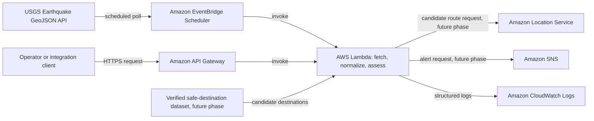

# Architecture

## Purpose and scope

The Disaster Early Warning & Evacuation Alert Route System is a college project intended to explore how public disaster data could be processed and how emergency information might eventually be routed to people who need it. The initial source is the public USGS Earthquake GeoJSON feed. The current local implementation fetches and normalizes observations with source identifiers and UTC timestamps, applies configurable freshness and duplicate handling, produces a separate explainable heuristic risk result, and can calculate a separate preliminary geographic impact radius and bounding box. It does not deploy AWS resources, issue official warnings, send notifications, identify shelters, or calculate routes.

## Intended architecture

Amazon Location Service and SNS are future integrations in this diagram, not configured resources. Actual routes and destinations would need validated data and emergency-authority review; this system cannot guarantee a safe evacuation route.

## Service and data-source responsibilities

- **USGS Earthquake API:** Public source of earthquake event GeoJSON. It provides observations, not project-specific evacuation advice or a guarantee of immediate completeness.
- **Amazon EventBridge Scheduler:** Future periodic trigger for unattended monitoring. It invokes the processing Lambda on a configured cadence.
- **AWS Lambda:** Future serverless processing boundary. It will fetch events, validate and normalize them, apply configured project risk rules, and coordinate downstream integrations. The current Python fetcher and heuristic run locally and are not deployed.
- **Amazon API Gateway:** Future HTTPS entry point for an operator-triggered or integration-triggered processing request. It is distinct from scheduled monitoring and should validate requests and apply appropriate authorization and throttling.
- **Amazon Location Service:** Future route-calculation service for candidate routes. It is not, by itself, a hazard-aware routing or shelter-verification system.
- **Amazon SNS:** Future delivery mechanism for approved notification messages to configured subscribers. No real notifications are sent in the current milestone.
- **Amazon CloudWatch Logs:** Intended location for operational logs and metrics from AWS components. Logs must avoid credentials and unnecessary personal data.
- **Verified safe-destination dataset:** A future maintained source of shelter/destination coordinates, capacity, operating status, accessibility, and provenance. It is not currently available or implemented.

## Data flow

1. For scheduled monitoring, EventBridge Scheduler invokes Lambda at a configured interval. Lambda requests a selected USGS GeoJSON feed, validates the response, normalizes source/event identifiers, magnitude, place, event/update timestamps, and coordinates, then applies freshness and duplicate policy before downstream processing.
2. For manual or integration requests, an authorized client calls an API Gateway HTTPS endpoint. API Gateway validates and forwards the request to the processing Lambda; this invocation is independent of the scheduled trigger, though both can call shared processing logic.
3. Local processing keeps observed event fields separate from derived outputs. `explain_risk()` returns a rule, reason, thresholds, and `low`/`moderate`/`high`/`unknown` label without mutating the observation. Missing magnitude is unknown, not low. The independent impact estimator returns its own explicitly heuristic radius/bounding box; it is not merged into or represented as observed data.
4. After fetching, callers may pass normalized observations to the separate local freshness processor. It uses UTC-aware processing time and an explicit age limit. Freshness is based on event origin time; duplicate selection uses the newest catalogue update time, falling back to event time. It reports accepted, stale, duplicate, and rejected records separately. Invalid timestamps are rejected, not interpreted as fresh. This processor is not yet wired into an AWS handler or the fetch function.
5. In later phases, estimates could be compared with verified destination data. Candidate routes could be requested from Amazon Location Service, reviewed against authoritative hazard information and policy, and only then used to prepare notifications through SNS.
6. The current implementation does not select destinations, calculate routes, notify anyone, or claim that the estimated region is affected or unsafe.

## Error handling, observability, permissions, and security

- Bound external HTTP requests with a timeout. Handle network and HTTP errors, invalid JSON, and unexpected feed structures explicitly; do not turn malformed data into a high-risk alert.
- Validate required event fields and coordinates. Treat optional or malformed values conservatively, and retain the event identifier for traceability.
- Use structured logs with invocation and event identifiers where available. Record failures and counts, not secrets or unnecessary personal data. Add alarms and operational dashboards in deployment phases.
- Configure bounded retries and dead-letter or failure destinations for asynchronous AWS invocations. Make processing idempotent so retries cannot repeatedly notify people about the same event.
- Give each Lambda role only the permissions it needs for its phase. Separate permissions for logs, location calculations, and SNS publishing; scope resource ARNs where supported. API Gateway must not expose an unauthenticated administrative action by default.
- Keep credentials out of source control. Prefer IAM execution roles and managed configuration/secrets where needed; protect transport with HTTPS and encrypt AWS data at rest. Apply retention limits and review privacy implications before collecting recipient information.
- Use rate limits and caching/backoff appropriate to the public USGS endpoint; do not assume it is an authenticated or guaranteed-availability service.

## Initial implementation limitations

The configurable magnitude-based risk label and impact-radius formula are educational placeholders, not official warnings, validated seismic-impact models, damage boundaries, or evacuation recommendations. The radius formula uses caller-provided base-radius, magnitude-scale, and depth-scale coefficients; these coefficients are not scientifically established thresholds. Magnitude and depth alone do not characterize local shaking, geology, population exposure, or risk. The bounding box and great-circle membership check describe geometry only. Freshness and duplicate policies are configurable application rules, not scientific criteria; the default age limit can exclude revised records for old events, while the in-memory processor does not persist deduplication state across runs. No authoritative shelter inventory, hazard-aware route avoidance, notification consent, or operational response workflow exists. Feed outages, delayed updates, and changing event magnitudes need additional operational handling. Human review and emergency-authority validation are required before any real-world use.