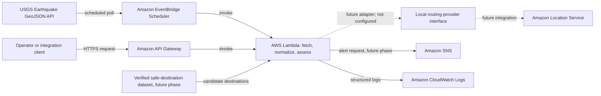

# Architecture

## Purpose and scope

The Disaster Early Warning & Evacuation Alert Route System is a college project intended to explore how public disaster data could be processed and how emergency information might eventually be routed to people who need it. The initial source is the public USGS Earthquake GeoJSON feed. The current local implementation fetches and normalizes observations with source identifiers and UTC timestamps, applies configurable freshness and duplicate handling, produces a separate explainable heuristic risk result, and can calculate a separate preliminary geographic impact radius and bounding box. It also defines a validated destination record/catalog contract and an injectable candidate-routing provider interface. It contains no real destination inventory and has no configured routing provider; it does not deploy AWS resources, issue official warnings, or send notifications.

## Intended architecture

The dashed routing adapter and Amazon Location Service integration are future work, not configured resources. The local interface currently fails explicitly when no provider is supplied. Destination records are a data contract only; no real destinations are included. Actual routes and destinations would need current validated data and emergency-authority review; no route can be guaranteed safe.

## Service and data-source responsibilities

- **USGS Earthquake API:** Public source of earthquake event GeoJSON. It provides observations, not project-specific evacuation advice or a guarantee of immediate completeness.
- **Amazon EventBridge Scheduler:** The deployed `disaster-early-warning-poll` schedule invokes the processing Lambda every 15 minutes in `ap-south-1`.
- **AWS Lambda:** `backend/src/lambda_handler.py` provides a locally testable handler deployed as `disaster-early-warning-processor`. It fetches events, validates and normalizes them, invokes the shared processing function, logs concise counts, and returns a summary. Regional event details are not included in its summary response.
- **Amazon API Gateway:** Future HTTPS entry point for an operator-triggered or integration-triggered processing request. It is distinct from scheduled monitoring and should validate requests and apply appropriate authorization and throttling.
- **Amazon Location Service:** Future route-calculation service for candidate routes. It is not, by itself, a hazard-aware routing or shelter-verification system.
- **Amazon SNS:** Future delivery mechanism for approved notification messages to configured subscribers. No real notifications are sent in the current milestone.
- **Amazon CloudWatch Logs:** Operational logs and metrics for deployed AWS components. Logs must avoid credentials and unnecessary personal data.
- **Verified safe-destination dataset:** A future maintained source of shelter/destination coordinates, capacity, operating status, accessibility, and provenance. It is not currently available or implemented.
- **Local destination contract:** `evacuation_destinations.py` validates coordinate ranges, required identity/name/type, optional capacity/availability, data source, and timezone-aware update timestamps. Unknown optional values are represented as `None`, with `"unknown"` as the default data-source label. The in-memory catalog rejects duplicate identifiers. It verifies structure, not the truth or reliability of supplied data; test fixtures are fictional and are not a destination inventory.
- **Local routing boundary:** `routing.py` accepts a provider implementing the `RoutingProvider` protocol and raises `RoutingProviderUnavailableError` if no provider is configured. No Amazon Location Service adapter or route calculation is implemented. Provider output would be a candidate route response only, not a safe-route determination.

## Data flow

1. For scheduled monitoring, the deployed EventBridge schedule `disaster-early-warning-poll` invokes Lambda every 15 minutes in `ap-south-1`. Lambda requests a selected USGS GeoJSON feed, validates the response, normalizes source/event identifiers, magnitude, place, event/update timestamps, and coordinates, then applies freshness and duplicate policy before downstream processing.
2. For manual or integration requests, an authorized client calls an API Gateway HTTPS endpoint. API Gateway validates and forwards the request to the processing Lambda; this invocation is independent of the scheduled trigger, though both can call shared processing logic.
3. `earthquake_processing.process_observations()` is shared by the CLI demo and Lambda handler. It applies freshness and duplicate filtering before risk classification, impact estimation, and regional relevance assessment, and returns JSON-serializable event results and summary counts. A finite negative USGS `properties.mag` is retained during normalization, then rejected individually by the risk classifier; it is never coerced to zero or assigned a risk level. An impact `ValueError` leaves a record with valid risk input accepted but marks its impact unavailable, while unexpected processing failures propagate. Tamil Nadu relevance is a separate per-event result; it does not change the magnitude-only risk classification.
4. Freshness processing uses UTC-aware processing time and a configurable age limit. Freshness is based on event origin time; duplicate selection uses the newest catalogue update time, falling back to event time. Invalid timestamps are rejected, not interpreted as fresh. State is in-memory per invocation and is not persisted across runs.
5. The deployed Lambda function `disaster-early-warning-processor` uses `lambda_handler.handler` and reads the feed URL and timeout from server-side configuration (or the fetcher's default USGS URL and 10-second timeout), ignores invocation-supplied feed URLs, and surfaces feed errors as `LambdaFeedError`. Its response remains a summary; the detailed regional assessment is available in local `process_observations()` records. It logs only the processing summary. `scripts/build_lambda_package.py` creates an allowlisted, standard-library-only ZIP with required imports at the archive root. AWS's current runtime table lists `python3.14` as supported on Amazon Linux 2023 and `python3.15` as public preview; recheck support and smoke-test on the selected runtime before deployment. The intended region is `ap-south-1`; HTTPS egress, a function timeout exceeding the configured HTTP timeout plus overhead, and scoped CloudWatch Logs permissions remain deployment prerequisites. A VPC-attached function needs correct private-subnet internet egress; a public subnet alone is insufficient. This change does not alter deployed AWS resources.
6. Callers may construct and validate destination records, but the application has no ingestion process or real destination data source. Unknown capacity or availability is not inferred from event data or impact estimates.
7. The current routing interface cannot calculate a route without an injected provider. Amazon Location Service is a future adapter; any resulting candidate route would still need review against current authoritative hazard information and policy before it could be considered for an operational workflow.
8. The current implementation does not select destinations, calculate routes, notify anyone, or claim that the estimated region is affected or unsafe.

## Tamil Nadu regional relevance

The pipeline uses a configurable rectangular assessment envelope, defaulting to 8.0–13.6° N and 76.2–80.4° E. This is an approximate broad mainland reference envelope for software testing, not an official state boundary, hazard map, or exposed-population boundary. Configure different bounds with `ProcessingConfig.tamil_nadu_area` and `TamilNaduAssessmentArea`.

An event inside the envelope is marked `inside_assessment_area`; for an outside event, the processor calculates great-circle distance to the nearest point of the rectangle and compares it with the same configured magnitude/depth radius heuristic used for impact estimation. Results are `within_heuristic_radius`, `outside_heuristic_radius`, or `unknown` when required inputs are missing/invalid. Missing or invalid coordinates cannot be assigned a distance. The result is stored separately from the event's `risk` classification and is not a threat label, damage prediction, official warning, or evacuation recommendation. The local processor includes it per accepted record; the Lambda response remains summary-only.

## Error handling, observability, permissions, and security

- Bound external HTTP requests with a timeout. Handle network and HTTP errors, invalid JSON, and unexpected feed structures explicitly; do not turn malformed data into a high-risk alert.
- Validate required event fields and coordinates. Treat optional or malformed values conservatively, and retain the event identifier for traceability.
- Use structured logs with invocation and event identifiers where available. Record failures and counts, not secrets or unnecessary personal data. Add alarms and operational dashboards in deployment phases.
- Configure bounded retries and dead-letter or failure destinations for asynchronous AWS invocations. Make processing idempotent so retries cannot repeatedly notify people about the same event.
- Give each Lambda role only the permissions it needs for its phase. Separate permissions for logs, location calculations, and SNS publishing; scope resource ARNs where supported. API Gateway must not expose an unauthenticated administrative action by default.
- Keep credentials out of source control. Prefer IAM execution roles and managed configuration/secrets where needed; protect transport with HTTPS and encrypt AWS data at rest. Apply retention limits and review privacy implications before collecting recipient information.
- Use rate limits and caching/backoff appropriate to the public USGS endpoint; do not assume it is an authenticated or guaranteed-availability service.

## Initial implementation limitations

The configurable magnitude-based risk label and impact-radius formula are educational placeholders, not official warnings, validated seismic-impact models, damage boundaries, or evacuation recommendations. The radius formula uses caller-provided base-radius, magnitude-scale, and depth-scale coefficients; these coefficients are not scientifically established thresholds. Magnitude and depth alone do not characterize local shaking, geology, population exposure, or risk. The bounding box and great-circle membership check describe geometry only. The destination model validates record shape, not source authority, freshness policy, operating status, capacity accuracy, accessibility, or safety; unknown values must not be treated as available. The routing boundary is not connected to a provider and calculates no routes. Even future provider routes will not be hazard-aware or certified safe without separate authoritative hazard/closure screening and review. Freshness and duplicate policies are configurable application rules, not scientific criteria; the default age limit can exclude revised records for old events, while the in-memory processor does not persist deduplication state across runs. No authoritative shelter inventory, hazard-aware route avoidance, notification consent, or operational response workflow exists. Feed outages, delayed updates, and changing event magnitudes need additional operational handling. Human review and emergency-authority validation are required before any real-world use.